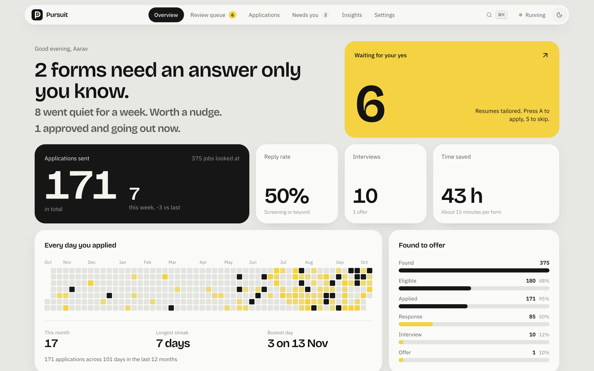

<p align="center">
  
</p>

<h1 align="center">Pursuit</h1>

<p align="center">
  Finds jobs overnight, tailors your resume, fills the application form and waits for your yes.
</p>

<p align="center">
  <a href="https://pursuit-jobs.vercel.app">Website</a>
</p>

<p align="center">
  <a href="LICENSE"></a>
  
  
</p>



Applying for jobs is mostly copy and paste. Pursuit does that part for you. It reads job posts from your Telegram groups and from Naukri, Instahyre, Wellfound, Indeed and Internshala, checks whether you actually qualify, picks or tailors a resume for the role, and fills in the application. Nothing is sent until you approve it in the dashboard.

It runs on your own machine. Your profile, resumes and answers stay in files there.

## What it does

- **Finds jobs.** Listens to the Telegram groups you're in and crawls the job boards every few hours.
- **Reads the post.** Pulls out the company, role, batch, experience and where to apply (form, careers page or email). The apply link is copied exactly as posted.
- **Checks you qualify.** Batch year and experience are checked first. If those pass, it scores how well your skills fit the role, out of 100. Jobs that don't fit are skipped with the reason written down.
- **Picks a resume.** Reuses a resume it already tailored for a similar role, or rewrites your LaTeX resume for this one using only what is already on it.
- **Fills the form.** Google Forms, Microsoft Forms, Greenhouse, Lever, Ashby, Zoho Forms, Keka and most careers pages. It applies directly on Naukri, Instahyre, Wellfound, Indeed and Internshala, and writes the email when a post says "send your resume to".
- **Waits for you.** Every job lands in a review queue. Press A to apply or S to skip. You can also let it send jobs above a fit score on its own.

## What it won't do

- **Make things up.** Answers come from your resume, your profile and the answers you saved. No invented employers, dates or numbers.
- **Solve captchas.** It fills everything else and opens the page for you to finish.
- **Guess what only you know.** Walk-in availability, relocation, current company and the like. It asks you once on Telegram, then remembers your answer for every form after.
- **Apply in bulk.** Each job board has a daily limit (20 to 30 by default) so your account isn't flagged.

## The dashboard

A local web app for everything the bot does.

| Screen | What it's for |
| --- | --- |
| Overview | What needs you today, applications sent, a year of activity |
| Review queue | Approve or skip jobs one by one, with fit score and the resume it will send |
| Applications | Every application by stage, with a reminder when one goes quiet |
| Needs you | Questions only you can answer, and forms that need you to finish them |
| Insights | Which boards reply, why jobs were skipped, week by week numbers |
| Settings | Approval mode, fit thresholds, daily limits, resume upload, saved answers |

## Requirements

- macOS or Linux
- Python 3.12
- Node.js 20 or newer
- [Tectonic](https://tectonic-typesetting.github.io) to compile LaTeX resumes (`brew install tectonic`)
- A [Gemini API key](https://aistudio.google.com/app/apikey) (the free tier works)
- A Telegram account, and API credentials from [my.telegram.org](https://my.telegram.org)
- A Gmail address with an [app password](https://myaccount.google.com/apppasswords), for applying by email

## Getting started

```bash
git clone https://github.com/mudit7011/pursuit-jobs.git
cd pursuit-jobs

python3.12 -m venv .venv && source .venv/bin/activate
pip install -r requirements.txt
playwright install chromium

cp .env.example .env
cp config/profile.example.json config/profile.json
cp templates/resume.example.tex templates/resume.tex
```

Then:

1. **Fill in `.env`.** [SETUP.md](SETUP.md) walks through getting each value.
2. **Fill in `config/profile.json`** with your details, skills and the roles you're looking for.
3. **Put your resume in `templates/resume.tex`.** Keep the commands from the example so tailoring keeps working. You can also upload a PDF later from the dashboard; it's turned into a draft for you to check first.
4. **Log in to the job boards once:**

   ```bash
   python setup_sessions.py naukri instahyre wellfound
   ```

   A browser opens for each site. Log in and close it. The session is saved in `sessions/`.

## Running it

Three processes, each in its own terminal:

```bash
python -m src.main          # the bot
python -m src.api           # the dashboard's API, on 127.0.0.1:8765
cd dashboard && npm install && npm run dev   # the dashboard, on localhost:3000
```

To keep the bot running in the background on macOS, `run.sh` restarts it if it ever exits. Point a launchd agent at it and set `BOT_LAUNCHD_LABEL` in `.env` to the agent's label; the dashboard's Start and Pause button then controls it.

## Configuration

| Where | What |
| --- | --- |
| `.env` | API keys and credentials, crawl intervals, optional paths. See `.env.example`. |
| `config/profile.json` | Your details, skills, job search keywords and the text of your application email |
| `templates/resume.tex` | The LaTeX resume every tailored version starts from |
| Dashboard settings | Approval mode, minimum fit, auto-apply threshold, daily limits per board, follow-up days |

## How it's built

```
src/
  main.py              starts the Telegram listener, crawler and approval worker
  monitor.py           Telegram listener (Telethon)
  parser.py            turns a job post into structured fields
  eligibility.py       batch and experience checks, then skill fit
  orchestrator.py      queues jobs for review and submits approved ones
  job_crawler.py       runs the job board scrapers on a schedule
  scrapers/            Naukri, Instahyre, Wellfound, Indeed, Internshala, LinkedIn
  applicators/         applies on each of those boards
  ats/                 one form engine with adapters for each ATS, plus answer rules and the answer bank
  resume_tailor.py     tailors and compiles the LaTeX resume
  resume_library.py    reuses a tailored resume when a new job is close enough
  resume_base.py       uploading a new base resume as a draft
  tracker.py           SQLite store for applications, events and settings
  api/server.py        FastAPI backend for the dashboard
dashboard/             Next.js dashboard
landing/               the project website
tests/                 pytest suite
```

Playwright drives a real browser for every form. Gemini reads job posts, scores fit and writes answers to open questions. Everything is stored in a local SQLite database under `data/`.

## Tests

```bash
JAC_HEADLESS=1 python -m pytest tests
```

## Known limitations

- LinkedIn Easy Apply is paused while it's rebuilt for LinkedIn's new application forms. LinkedIn jobs are still found.
- Uploading resumes to Google Forms needs a Google service account (`GOOGLE_SERVICE_ACCOUNT_B64`). Without it, Google Forms that ask for a resume file can't be submitted automatically.
- Job boards change their pages often. When a scraper or applicator breaks, the job is marked failed with the reason, and nothing is sent.

## Use it responsibly

Pursuit acts on your behalf with your own accounts. Read the terms of the job boards you use, keep the daily limits low, and review what goes out. You're responsible for the applications sent in your name.

## Contributing

Bug reports and pull requests are welcome. Read [CONTRIBUTING.md](CONTRIBUTING.md) first. For security issues, see [SECURITY.md](SECURITY.md).

## Licence

[MIT](LICENSE) © Mudit Kumar
